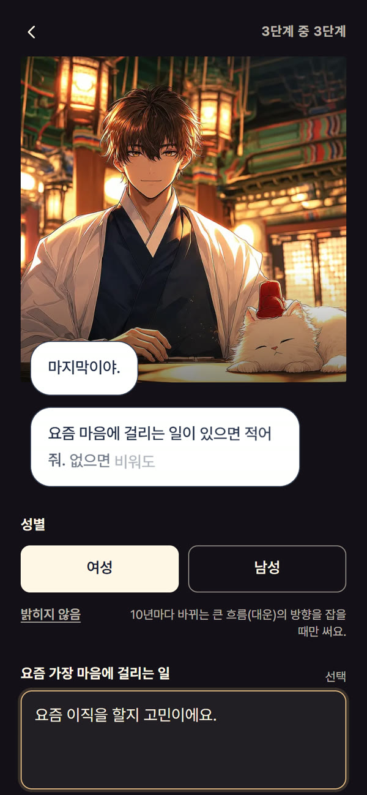
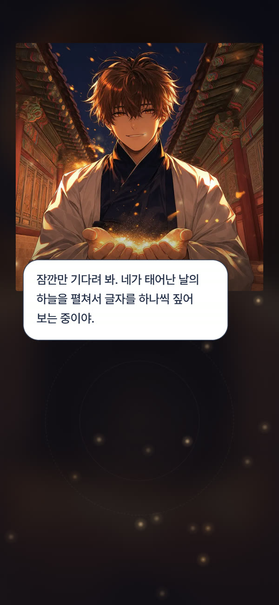
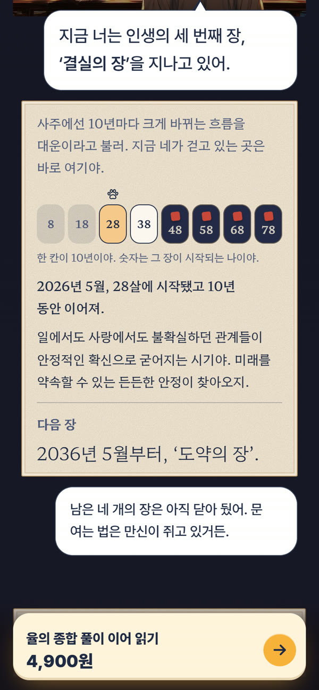
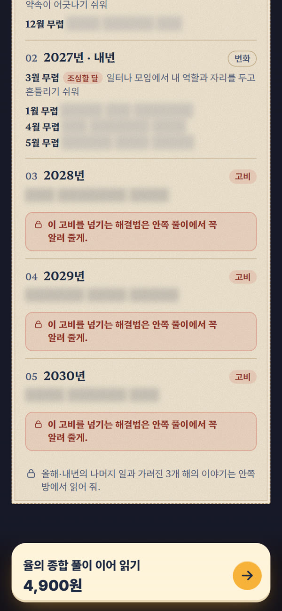
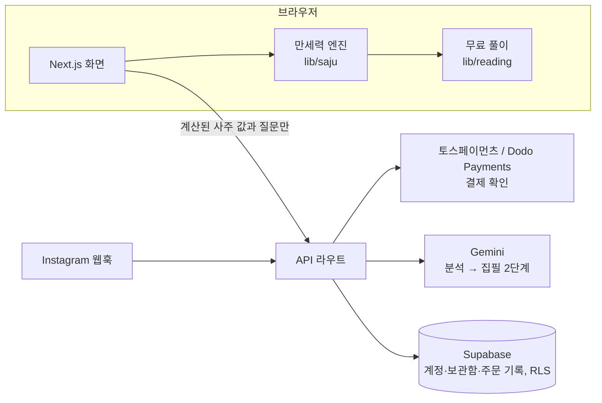

# 단골 DANGOL

생년월일을 넣으면 신당의 무당 캐릭터가 사주를 웹툰처럼 읽어 주는 웹 서비스입니다. 한국어·영어·일본어로 운영 중이고, 무료 풀이와 AI가 쓰는 유료 테마 풀이를 함께 제공합니다.

- 서비스: https://dangolsaju.app (실제 결제가 이루어지는 운영 서비스)
- 기간: 2026년 10월 15일 ~ 진행 중 (커밋 579개)
- 역할: 2인 팀에서 기획, 개발, 결제 연동, 운영을 맡았습니다. 전체 커밋의 약 90%를 직접 작성했습니다.


## 무료 풀이 흐름

이름과 생년월일, 태어난 시각과 도시를 받으면 브라우저 안에서 만세력을 계산하고, 결과를 무당 율의 대사와 그림 칸으로 이어 보여 줍니다. 아래는 실제 화면을 녹화한 것입니다(1.6배속).

<p align="center"></p>

원본 영상: [docs/media/free-reading-flow.mp4](docs/media/free-reading-flow.mp4)

| 시작 | 입력 | 계산 중 | 결과 |
|---|---|---|---|
|  |  |  |  |

| 여덟 글자 | 타고난 모습 | 10년 흐름(대운) | 앞으로 5년 |
|---|---|---|---|
|  |  |  |  |

## 유료 테마 풀이

연애, 궁합, 10년 대운, 2027년 운세, 재회 같은 주제마다 다른 무당 캐릭터가 맡는 '방'이 있습니다. 결제하면 서버가 사주 계산값을 바탕으로 AI 풀이를 쓰고, 화면은 웹툰 칸과 줄글로 나눠 보여 줍니다.

| 방 목록 | 율의 방 | 연의 방 | 재회 사주 |
|---|---|---|---|
|  |  |  |  |

크리스마스 시즌에는 40문항 연애 유형 테스트와 사주를 합친 특별판을 따로 만들었습니다.

| 크리스마스판 | 40문 40답 | 영어 | 일본어 |
|---|---|---|---|
|  |  |  |  |

## 구조



- 화면: Next.js 16 App Router, React 19, TypeScript, Tailwind CSS 4
- 사주 계산: lunar-javascript(만세력), luxon(시간대), city-timezones(출생 도시 좌표)
- 서버: Vercel, Supabase(인증·Postgres·RLS), Upstash Redis
- 결제: 토스페이먼츠(원화) 직접 연동, Dodo Payments(달러·엔화, 판매 대행)
- AI: Google Gemini, 풀이 검사·재시도 파이프라인
- 테스트: vitest

## 설계에서 신경 쓴 점

**개인정보를 서버로 보내지 않습니다.** 사주는 브라우저에서 계산합니다. 로그인하지 않은 사람의 이름과 생년월일은 sessionStorage에만 두고 URL에도 넣지 않습니다. 유료 풀이를 요청할 때도 서버에는 계산된 사주 값과 질문만 보내고, 서버는 받은 값을 다시 검사합니다(`src/lib/rooms/request.ts`).

**같은 입력이면 같은 결과가 나옵니다.** 만세력 엔진과 무료 풀이는 DOM, 저장소, 현재 시각에 기대지 않는 순수 함수로 작성했습니다. '지금'은 인자로 받고, 문장 고르기는 입력값의 해시로 정합니다. 그래서 테스트에서 결과를 그대로 고정해 확인할 수 있습니다.

**결제는 서버가 확인한 것만 믿습니다.** 결제사에서 돌아온 주소의 값은 쓰지 않고, 서버가 결제사 조회 API로 다시 확인한 뒤 영수증을 만듭니다. 주문 번호에는 풀이 내용과 가격 조건을 서명으로 묶어서 다른 풀이에 재사용할 수 없게 했습니다(`src/lib/payments`).

**풀이가 끊기지 않게 했습니다.** AI 풀이는 수십 초가 걸려서, 로그인한 사용자는 서버가 응답을 먼저 돌려준 뒤 백그라운드에서 끝까지 써서 보관함에 저장합니다. 화면을 닫았다가 돌아와도 이어서 읽을 수 있습니다.

**세 언어를 따로 씁니다.** 번역하지 않고 한국어, 영어, 일본어 문구를 각각 그 언어의 말투로 썼습니다(`src/content/ko`, `en`, `ja`).

## 폴더

```
src/
  app/            화면과 API 라우트 (결제, 결제 확인, 웹훅, 이용 통계)
  components/     화면 구성 요소 (웹툰 칸, 말풍선, 결제 창, 크리스마스판 등)
  content/        한국어·영어·일본어 문구
  lib/
    saju/         만세력 엔진 (순수 함수)
    reading/      무료 풀이와 성격·흐름 계산
    payments/     토스페이먼츠·Dodo 결제, 주문 서명
    rooms/        유료 풀이 요청 검사, 풀이 칸 배정
    xmas/         크리스마스판 40문항 테스트와 날짜 계산
    account/      로그인, 저장한 사람, 보관함
    dm/           인스타그램 댓글 → DM 자동 응답
tests/            단위 테스트
docs/             README에 쓴 화면과 영상
```

## 실행

```bash
npm install
npm test
```

이 저장소는 공개용 사본이라 유료 풀이를 쓰는 AI 지침과 생성 코드, 견본 풀이, 관리자 도구, 데이터베이스 설정, 내부 문서를 뺐습니다. 그래서 빌드는 되지 않고, 남은 코드의 단위 테스트(69개 파일, 1,429개)만 돌릴 수 있습니다. 운영 저장소 전체는 TypeScript 약 7만 줄, 테스트 파일 120개입니다.

## 저작권

© 도깨비웍스(DokkaebiWorks). 모든 권리를 보유합니다. 코드를 읽는 것은 자유롭지만 허락 없이 복제하거나 다른 서비스에 쓸 수 없습니다. 그림과 캐릭터도 같습니다.
